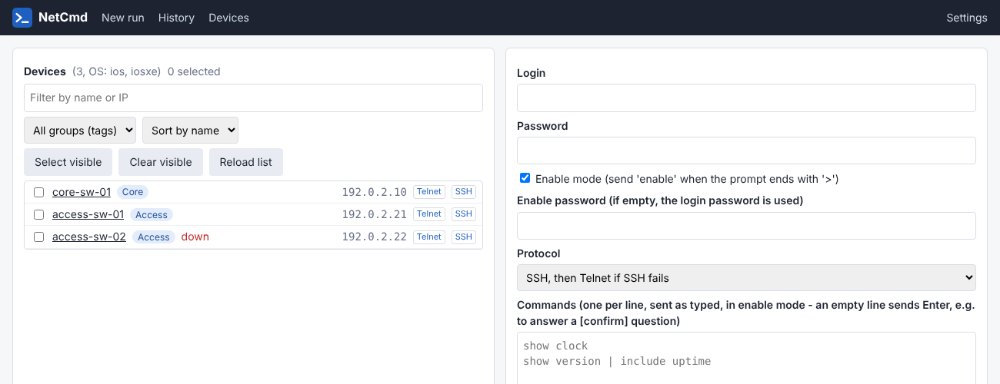

# librenms-toolkit

*Developed by [Walyu PTE LTD](https://www.walyu.com) - IT research department.*

Companion tools for a [LibreNMS](https://www.librenms.org/) server managing Cisco switches:

| Component | Type | Purpose |
|---|---|---|
| [NetCmd](netcmd/) | Standalone web app (Python, port 8090) | Send the same CLI commands to many Cisco devices (SSH / Telnet), with per-device history and outputs; MAC Trace (locate the switch port of a MAC address) |
| [CiscoEox](plugins/CiscoEox/) | LibreNMS local plugin | Cisco PSIRT advisories (openVuln API) and hardware / software End-of-Life dates on each device page |
| [Comment](plugins/Comment/) | LibreNMS local plugin | Device notes with Markdown, simple HTML, line breaks, inline editor and a common first line |
| [Netcmd](plugins/Netcmd/) | LibreNMS local plugin | Menu entry and device page links to NetCmd (new run, MAC trace, history) |

Developed for Ubuntu 26.04 with the current LibreNMS (Laravel 12, PHP 8.5).



## Installation

Each component ships a self-contained installer (run as root on the LibreNMS server). An existing
installation is backed up to `/root` before being replaced.

```bash
sudo bash netcmd/install-netcmd.sh
sudo bash plugins/CiscoEox/install-ciscoeox.sh
sudo bash plugins/Comment/install-comment.sh
sudo bash plugins/Netcmd/install-netcmd-plugin.sh
```

The source files next to each installer are the same files the installer writes; they are provided
for review.

Local plugins live in `/opt/librenms/app/Plugins/<Name>/`. This folder is ignored by git in
LibreNMS, so the plugins never block the LibreNMS daily update (`daily.sh`). To remove a plugin:

```bash
sudo mv /opt/librenms/app/Plugins/<Name> /root/<Name>.removed
```

## NetCmd

- Device list from the LibreNMS API (`/api/v0/devices`), filtered by OS (default `ios,iosxe`), with
  LibreNMS device groups as filter, sort by name or IP, preselection with `/?ip=<address>`;
  Telnet, SSH and History links on each device.
- Commands sent as typed with Netmiko, in parallel; `enable` handling (login password or a specific
  enable password).
- Any device prompt (exec, config, config-xxx) ends a command; `[confirm]`, `[yes/no]` and
  `... [default]?` questions too. An empty line in the command list sends Enter (default answer).
  NetCmd never answers a question on its own.
- Status per device: `ok`, `potential error` (lines starting with `%`), `cmd_error` (known IOS
  errors, timeout), `conn_error`.
- Scripts: saved command sets (Scripts menu: add, edit, rename, delete), loaded on the New run page
  from a drop-down list; "Save and Run" saves the commands under a script name, then runs them.
- History in SQLite (runs, per-device outputs), text export. Passwords are never stored.
- Settings page: links from device names to LibreNMS, `telnet://` and `ssh://` links, group badges,
  custom logo (browser tab and title bar), VRF discovery command and lookup field (MAC Trace).
- MAC Trace page: locates the switch port of a MAC address (any notation). Start switches are chosen
  from the device list and tried in order. On each switch, `show mac address-table address <mac>`
  gives the port; when the port (or, for a Port-channel, one of its members) is a trunk with a CDP
  neighbor, the trace continues on the neighbor management IP; otherwise the port is the final port
  (`show mac address-table interface` and the `show lldp neighbors` line of the port). Every switch
  traversed is linked to LibreNMS; traces are kept in the history with a text export. Port of
  [CiscoMacTrace](https://github.com/walyu-com/CiscoMacTrace).
- MAC Trace by IP address: ARP lookup on a chosen gateway (L3 device). VRF field: only that VRF;
  VRF empty with "Discover VRFs": global table, then every VRF listed by the discovery command
  (Settings, default `show vrf brief`, VRF names read in the `Name` column); otherwise global
  table only. An IP with several MACs (VRFs) is listed, not traced. An IP whose ARP entry is on
  another device (e.g. a firewall) is reported as not found: use the MAC address.
- Configuration: `/etc/netcmd/netcmd.env` (LibreNMS URL and API token, OS filter, timeouts, port).

NetCmd has no authentication of its own: restrict access to port 8090 (firewall) to the admin
networks.

## CiscoEox

- Advisories from the Cisco PSIRT openVuln API for the OS and version known by LibreNMS (free
  Cisco account and an application registered at <https://apiconsole.cisco.com>, grant type
  Client Credentials). The API matches on the version only, not on the configuration: an advisory
  may not apply to a device where the affected feature is disabled.
- "Disable scope" per advisory: Local (this device) or Global (all devices); disabled advisories are
  greyed out and moved to the end of the list.
- Hardware and software lifecycle tables (End-of-Sale, End of Security Support, Last Date of
  Support, bulletin URL) with "Rescan hardware" / "Rescan IOS" buttons that add the PIDs and
  release trains present in LibreNMS. Dates come from the public Cisco EoL bulletins; the Cisco
  EoX API requires a Smart Net Total Care or PSS contract and is not used.
- Device pages read a cache only; the cache is refreshed every 6 hours by
  `/etc/cron.d/librenms-ciscoeox` (`bin/refresh.php`) or by the "Refresh advisories now" button.

## Comment

- Renders the standard LibreNMS device notes with Markdown, simple HTML (links, bold, lists,
  tables...) and line breaks; attributes, scripts and unsafe links are removed.
- Inline editor (saved through the LibreNMS notes route and permissions), configurable height.
- "Common first line" shown on every device, with placeholders `{ip}`, `{sysname}`, `{name}`, `{id}`.
- Menu entry listing every device with notes.

## License / Credits

This software has been developed by Walyu PTE LTD - IT research department.
<https://www.walyu.com> - Incorporated in Singapore.

(C) Copyright 2026 Walyu PTE LTD

Released under the Apache License 2.0 (see [LICENSE](LICENSE)).

Built on and for:

| Project | Use | License |
|---|---|---|
| [LibreNMS](https://www.librenms.org/) | Host application of the plugins, device inventory API | GPL-3.0-or-later |
| [Netmiko](https://github.com/ktbyers/netmiko) | SSH / Telnet sessions to the devices (NetCmd) | MIT |
| [Flask](https://flask.palletsprojects.com/) / [Waitress](https://docs.pylonsproject.org/projects/waitress/) | NetCmd web application and server | BSD-3-Clause / ZPL-2.1 |
| [CiscoMacTrace](https://github.com/walyu-com/CiscoMacTrace) | MAC Trace logic (NetCmd), same author | Apache-2.0 |
| [Requests](https://requests.readthedocs.io/) | NetCmd calls to the LibreNMS API | Apache-2.0 |
| [Cisco PSIRT openVuln API](https://developer.cisco.com/docs/psirt/) | Security advisories (CiscoEox) | Cisco API terms of service |

Cisco, IOS and Catalyst are trademarks of Cisco Systems, Inc. This project is not affiliated with
or endorsed by Cisco or by the LibreNMS project.
